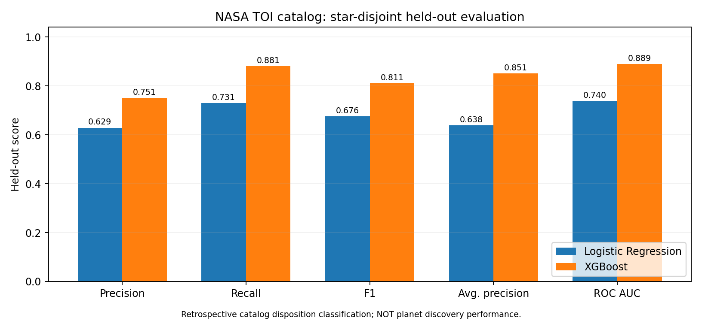
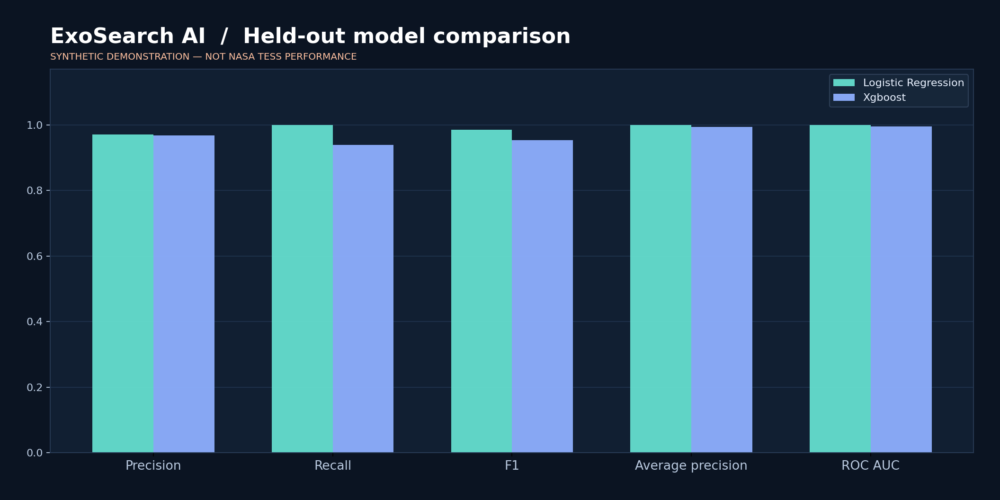
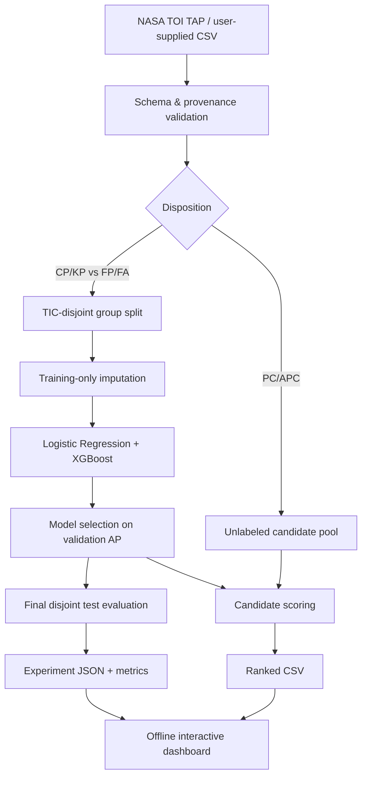

<div align="center">
  <h1>✳ ExoSearch AI</h1>
  <p><strong>Transparent TESS Candidate Prioritization · Reproducible Scientific ML</strong></p>
  <p><code>Python</code> · <code>Logistic Regression</code> · <code>XGBoost</code> · <code>TIC-disjoint evaluation</code> · <code>Plotly</code> · <code>NASA TOI TAP API</code></p>
</div>

> **Status — retrospective NASA TOI catalog experiment executed on user-supplied data.** The project was originally validated using synthetic fixtures; it has now also run on a user-supplied 9-page PDF export of a NASA TOI-shaped CSV. The resulting table contains 8,148 entries. **The snapshot was not independently re-downloaded from NASA.** Results represent retrospective catalog disposition classification, *not* exoplanet confirmation, future prediction accuracy, or raw-light-curve transit detection. See [real-data experiment and limitations](docs/REAL_NASA_RESULTS.md).

## Research objective

ExoSearch AI studies whether catalog measurements can help **prioritize unresolved TESS Objects of Interest (TOIs)** for follow-up review. It compares two classifiers trained on previously assigned TESS Follow-up Observing Program Working Group (TFOPWG) dispositions: `CP` and `KP` as the positive class; `FP` and `FA` as the negative class. Objects with statuses `PC` and `APC` are **never used as labeled examples** and are instead ranked after training.

**This is not a transit-search pipeline operating on TESS light curves, and its ranking is not an astrophysical planet confirmation.** Those are distinct tasks. The NASA catalog changes over time and the availability/values of parameters can depend on follow-up campaigns. See [methodology](docs/METHODOLOGY.md).

## What it does

- Downloads a real NASA Exoplanet Archive TOI snapshot through the official TAP service, records its SHA-256 checksum, acquisition time, schema, and provenance.
- Validates schemas, status vocabulary, numeric parameters, duplicate TOIs, and conflicting records.
- Prevents target-label leakage: outcome labels, TOI identifiers, star identifiers, and catalog update dates are not used as predictors.
- Splits **by TESS Input Catalog (TIC) host-star ID**; train, validation, and final holdout contain no shared host-star identifiers.
- Trains Logistic Regression and XGBoost with imputation fitted only to training data.
- Selects a winning model using **validation average precision** and evaluates both models on a held-out test set.
- Calculates precision, recall, F1, average precision, ROC-AUC, Brier score, confusion matrices, and PR/ROC curves.
- Includes an explicitly marked random-split reference showing potentially shared host stars, an ablation study omitting inferred planet radius, and grouped-star bootstrap intervals.
- Scores only unresolved `PC`/`APC` candidate records and exports a ranked CSV for astronomer review.
- Generates an **offline, interactive research dashboard**, with plots of real pipeline outputs and a searchable candidate table.
- Offers a deterministic synthetic end-to-end demo **solely for verifying software operation**.
- Includes unit tests, integration tests, pre-publication validation notes, and GitHub Actions CI.

## Results — user-supplied NASA TOI catalog (retrospective)

| Held-out, TIC-disjoint test | Logistic Regression | XGBoost |
|---|---:|---:|
| Precision | 0.629 | 0.751 |
| Recall | 0.731 | 0.881 |
| F1 | 0.676 | 0.811 |
| Average precision | 0.638 | 0.851 |
| ROC-AUC | 0.740 | 0.889 |

- 2,834 labeled TOIs, grouped by host-star TIC ID; 5,312 unresolved candidates ranked (not evaluated as labeled targets).
- These measured values come from the provided PDF-to-CSV snapshot; NASA live-source integrity was not independently verified.
- See [full methodology, limitations, and conversion provenance](docs/REAL_NASA_RESULTS.md).



## Interface



*Actual plot rendered from a locally executed experiment on **simulated** data. Not a screenshot of the interactive app and not real NASA research outcomes. Run the demo to open the interactive offline dashboard.*

## Architecture



## Quick start

### Requirements

- Python 3.11 or 3.12 (newer versions may work but CI targets 3.11/3.12).
- Internet needed only to install dependencies and obtain a NASA catalog snapshot. Inference, evaluation, and dashboard are local once dependencies and data are available.

```bash
python3 -m venv .venv
source .venv/bin/activate          # macOS or Linux
python -m pip install -e '.[dev]'
python -m pytest -q
```

### Demo — safe and synthetic

```bash
exosearch demo --output artifacts/demo --stars 350
exosearch rank --experiment-dir artifacts/demo --top 10
```

Open `artifacts/demo/index.html` in your browser (it references the adjacent `plotly.min.js` bundle). This is a **smoke test**, not a scientific benchmark.

### NASA TOI experiment — actual data

```bash
exosearch fetch --output data/raw/nasa_toi.csv
exosearch inspect --input data/raw/nasa_toi.csv
exosearch train --input data/raw/nasa_toi.csv --output artifacts/real
exosearch rank --experiment-dir artifacts/real --top 20
```

Open `artifacts/real/index.html` to inspect real evaluation metrics **only after those commands finish successfully**. The `fetch` command requires access to NASA's TAP server. It deliberately fails rather than creating a fake replacement dataset when NASA is unavailable.

If already downloaded from NASA, you can use your CSV directly, as long as the required named columns are present:

```bash
exosearch train --input /path/to/toi_snapshot.csv --output artifacts/real
```

The `experiment.json` records the source CSV hash, experimental data type, class mapping, versions, feature whitelist, split counts, held-out model metrics, and the model selected by validation average precision.

### Re-score unresolved candidates

```bash
exosearch predict --model artifacts/real/model.joblib \
  --input data/raw/nasa_toi.csv --output artifacts/real/ranked_latest.csv
```

**Security note:** `joblib` models are Python pickle-based. Load *only trusted, locally produced model files*; opening unknown third-party artifacts can execute arbitrary code.

## Labels and interpretation

| TFOPWG disposition | Meaning | How used |
|---|---|---|
| `CP` | Confirmed planet | Positive training label |
| `KP` | Known planet | Positive training label |
| `FP` | False positive | Negative training label |
| `FA` | False alarm | Negative training label |
| `PC` | Planetary candidate | Unlabeled candidate to rank |
| `APC` | Ambiguous planetary candidate | Unlabeled candidate to rank |

The deployed rank is **model similarity to known/confirmed dispositions** under this dataset. It is not a probability that the object exists, it does not guarantee new planet discoveries, and it is not a replacement for human validation.

### Important limitations

- **Retrospective data leakage / label-related bias:** Published transit attributes may have been updated after follow-up and can indirectly encode confirmation decisions. A historically correct early-warning model would need time-stamped snapshots with parameters frozen as of each decision date.
- **Target selection and ascertainment bias:** The TFOPWG disposition distribution is not a random sample of all astrophysical signals.
- **Catalog classification, not photometric detection:** Models use tabular parameters, not raw time-series light curves.
- **Real catalog experiment completed, but no prospective external validation:** the user supplied a PDF with CSV-formatted NASA TOI fields, which was converted and evaluated offline. This snapshot was not independently authenticated against the live NASA API. Historical/temporal validation is still outstanding.
- **No comparison with ExoMiner(++):** Full benchmark parity would require matching inputs, test cohorts, label definitions, and computational conditions.
- **No astrophysical confirmations:** Predictions suggest follow-up prioritization only.

See [research methodology](docs/METHODOLOGY.md), [dataset card](docs/DATASET_CARD.md), [validation report](docs/VALIDATION.md), and [historical provenance](docs/ORIGIN_AND_CREDITS.md).

## Original university project and this repository

This repository is a **new independent codebase** inspired by the original CAI 4002 group project *ExoSearch_AI*, documented in a report dated April 25, 2026. The original group comprised Maria Amaya, Fatima Humbatova, Adrian Perez Galindo, and Maksim Pikalov; Fatima identifies herself as the team leader. The source code of that earlier work was unavailable when this version was recreated. Results, commits, screenshots, and experiments from this new repository should **not** be attributed to the original historical implementation or to all original team members.

This project is an educational research tool, not an official NASA application or endorsement.

## Data and citation

- NASA Exoplanet Archive, *TESS Project Candidates (TOI) table* — https://exoplanetarchive.ipac.caltech.edu/docs/TESSMission.html
- NASA Exoplanet Archive, *TOI column definitions* — https://exoplanetarchive.ipac.caltech.edu/docs/API_TOI_columns.html
- NASA Exoplanet Archive, *TAP API documentation* — https://exoplanetarchive.ipac.caltech.edu/docs/TAP/usingTAP.html

NASA archives and original studies should be acknowledged following the archive's current citation instructions in any scientific paper.

## License

MIT for this independent codebase. NASA catalog data is **not included** in the repository, and its use remains subject to the originating archive's terms and citation guidelines.
